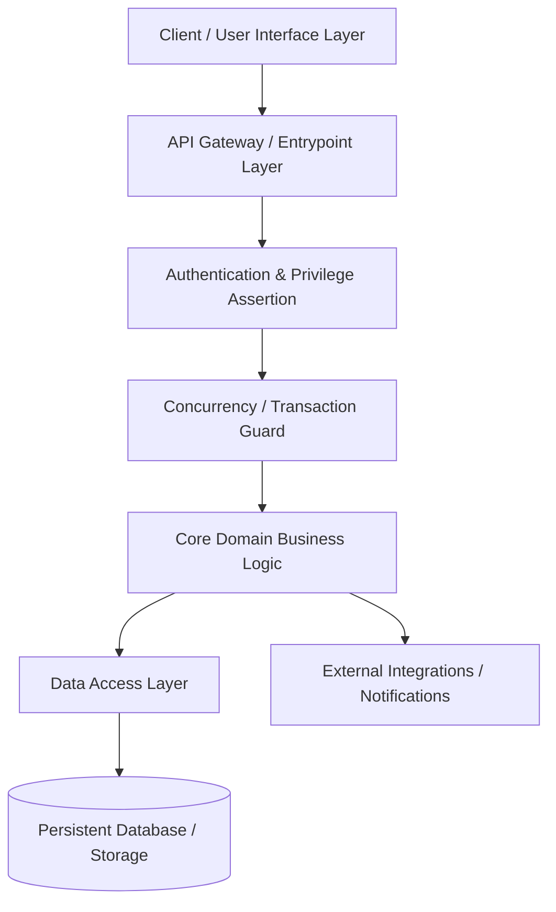
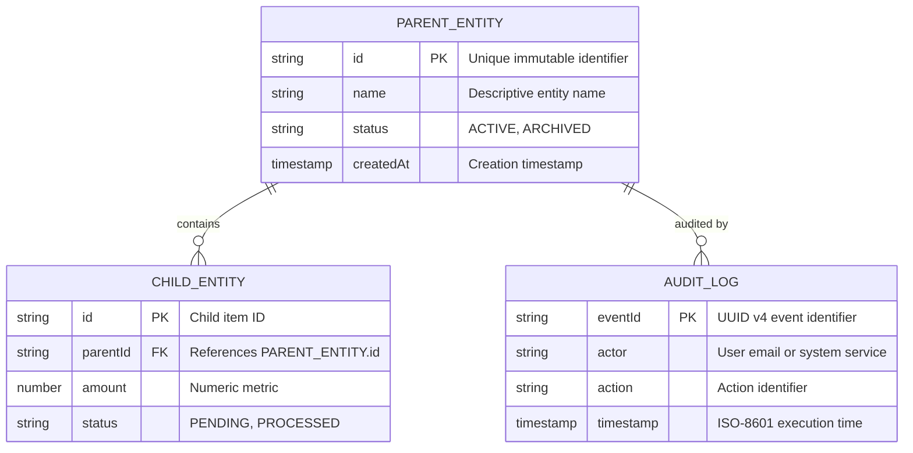
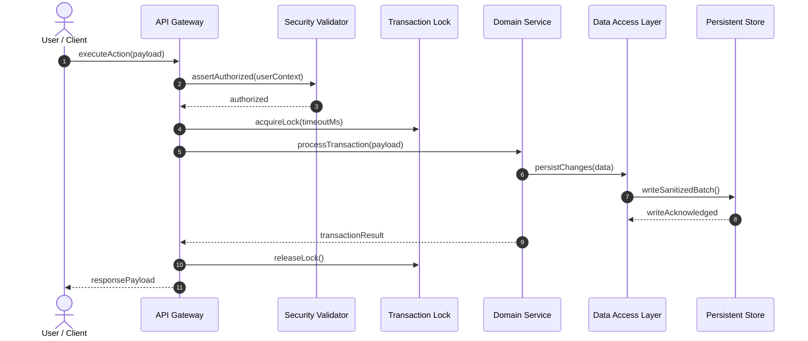
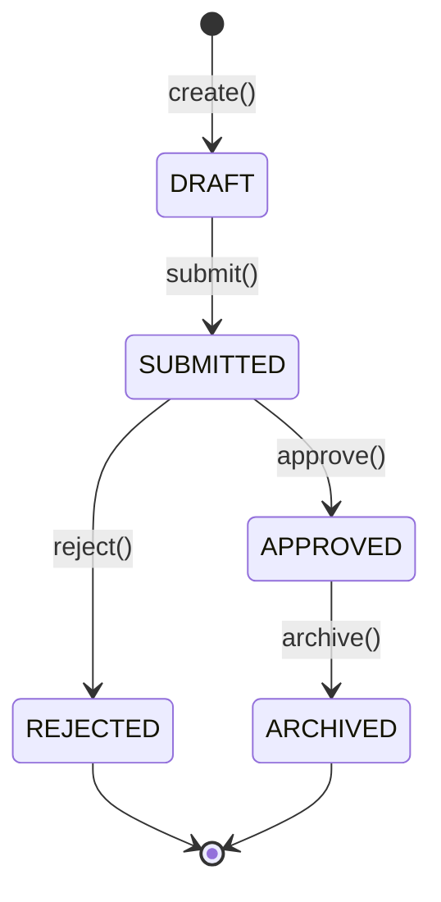

# [System / Service Name] - Architecture Specification & Engineering Design

**System Name:** [System or Microservice Name]<br>
**Repository:** `[org]/[repo-name]`<br>
**Document Status:** [DRAFT | UNDER REVIEW | APPROVED | IMPLEMENTED]<br>
**Lead Engineer / Author:** [Author Name]<br>
**Security / Tech Reviewer:** [Reviewer Name]<br>
**Runtime Environment:** [e.g., Google Apps Script V8 / Node.js 20 / Cloud Run / Kubernetes]<br>
**Applicable Requirements:** [Project requirements, or pending]<br>

---

## 1. Executive Summary & Business Goals

### 1.1 Objective
[Provide a clear 2–3 paragraph summary describing the business problem, the technical solution, and the organizational impact.]

### 1.2 Non-Goals
[Explicitly document out-of-scope capabilities to prevent scope creep and adhere to the YAGNI principle.]

---

## 2. Requirements Specification

### 2.1 Functional Requirements (FR)
* **FR-01:** [Core requirement 1]
* **FR-02:** [Core requirement 2]
* **FR-03:** [Core requirement 3]

### 2.2 Non-Functional Requirements (NFR)
* **NFR-01 (Performance):** [Latency, throughput, or execution quota limits]
* **NFR-02 (Security - Least Privilege):** [Access control, authentication, authorization rules]
* **NFR-03 (Data Integrity & Concurrency):** [Locking strategy, transaction isolation, idempotency]
* **NFR-04 (Auditability):** [Immutable audit logging, correlation IDs, retention policy]

---

## 3. High-Level Architecture & Component Decomposition

### 3.1 System Context & Component Architecture


### 3.2 Component Roles & Boundaries
| Component | Responsibility | Boundary / Prohibitions |
| :--- | :--- | :--- |
| **API Layer** | Request routing, schema input validation | No business calculation or direct database operations |
| **Service Layer** | Pure business rules, domain calculations | Decoupled from transport and persistence specifics |
| **Data Access Layer** | Query execution, sanitization, ORM/Sheet mapping | Enforces data sanitization and transaction locks |
| **Security Utilities** | Role checking, sanitizers, audit log emission | Stateless, deterministic, high unit-test coverage |

---

## 4. Data Architecture & Storage Schema

### 4.1 Master Entity Models
```typescript
// Define key data contracts, enums, and interfaces
export type EntityStatus = 'ACTIVE' | 'PENDING' | 'ARCHIVED';

export interface CoreEntity {
  id: string;
  createdAt: string;
  updatedAt: string;
  status: EntityStatus;
}
```

### 4.2 Entity-Relationship Diagram (ERD)


### 4.3 Storage / Schema Mapping
| Storage Field / Column | Field Type | Nullable | Sanitization Required | Notes |
| :---: | :--- | :---: | :---: | :--- |
| 1 | `ID` | No | No | Unique immutable identifier |
| 2 | `ENTITY_NAME` | No | Yes | Human-readable identifier |
| 3 | `STATUS` | No | No | Controlled state machine |

---

## 5. Workflows, Sequences & State Machines

### 5.1 Primary Transaction Sequence Workflow


### 5.2 State Machine & Entity Lifecycle


---

## 6. Security & Threat Modeling (STRIDE Analysis)

| Threat Category | Potential Attack Vector | Mitigating Control / Architectural Defense |
| :--- | :--- | :--- |
| **Spoofing** | Attacker impersonates legitimate user | Strong session identity verification via trusted identity provider |
| **Tampering** | Caller mutates calculated values in payload | Server-authoritative calculation; untrusted parameters dropped |
| **Repudiation** | User denies performing state change | Structured audit logging with user keys and immutable timestamps |
| **Information Disclosure** | Unauthorized data read across tenant/user | Server-side query filtering and role-based access control |
| **Denial of Service** | Resource exhaustion / rate limit saturation | Transaction locks, rate limiting, and quota guards |
| **Elevation of Privilege** | Standard user calls administrative RPC | First-statement role verification on all privileged endpoints |

---

## 7. Deployment, CI/CD & Verification

* **Environments:** Development Sandbox vs. Production.
* **CI/CD Quality Gates:** Type-checking, linting, and automated unit test suite execution before release.
* **Disaster Recovery & Rollback:** Version-controlled releases with automated rollback capability.
